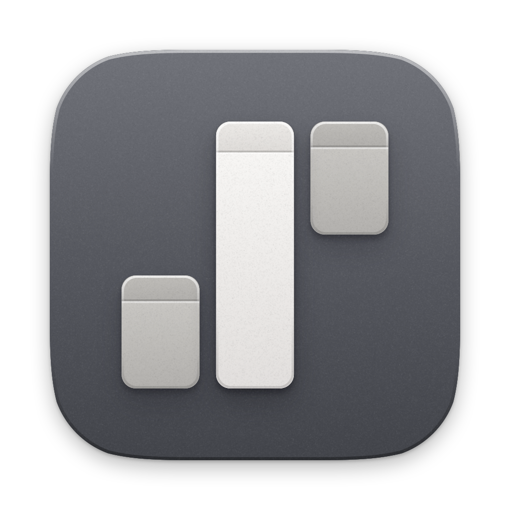

# Scene

Scene saves the windows you have open on your Mac, including which display and which desktop (Space) each one is on, and puts them back later.

## What it saves

- Every app window: position, size, display and desktop.
- What the window shows, when Scene can read it:
  - Finder folders
  - documents (reported by the app, or found through Spotlight from the window title)
  - tabs in Safari, Chrome (incognito windows too) and Firefox, with the active tab

## How restoring works

macOS has no public way to move a window to another desktop, so Scene doesn't try. It visits each desktop instead, by pressing your Mission Control shortcuts for "Move left a space" and "Move right a space". On each desktop it opens the windows that are missing and moves and resizes the rest. Then it goes back to the desktop you started from.

While it switches desktops, the keyboard is blocked so you can't switch desktops by accident. Trackpad swipes are blocked too. The block lasts 8 seconds at most.

Before restoring, Scene can close windows on every desktop. You can choose which:

- **windows not in the scene**: windows that belong to the scene and are already on the right desktop stay open, everything else is closed
- **the scene's windows**: windows of the apps in the scene
- **all windows**

Windows are closed with their close button, so apps can still ask you to save. If one does, Scene pauses until you answer.

A scene saved with an external monitor can be restored on the Mac alone, and the other way round. Desktop 1 and 2 of the monitor map to desktop 1 and 2 of the Mac, and windows are resized proportionally.

## Requirements

- macOS 15 Sequoia or later, Apple Silicon or Intel
- "Displays have separate Spaces" turned on (the default)
- The Mission Control shortcuts "Move left a space" and "Move right a space" turned on in System Settings › Keyboard › Keyboard Shortcuts. Scene reads them from there.

## Install

1. Download `Scene-1.0.dmg` from [Releases](../../releases) and drag Scene to Applications.
2. Scene is not notarized, so macOS blocks it the first time. Open System Settings › Privacy & Security, scroll down and click **Open Anyway**. You can also clear the quarantine flag from Terminal:
   ```
   xattr -dr com.apple.quarantine /Applications/Scene.app
   ```
3. Give Scene Accessibility access when it asks (System Settings › Privacy & Security › Accessibility). macOS will also ask before Scene reads Finder, Safari or Chrome.

## Build from source

You need the Xcode Command Line Tools (Swift 6).

```
./build.sh         # build/Scene.app for this Mac
./make_dmg.sh      # universal build/Scene-1.0.dmg
```

## Things to know

- Scene uses private macOS APIs, read-only: `CGSGetActiveSpace`, `CGSCopyManagedDisplaySpaces` and `CGSCopySpacesForWindows` to read desktops, plus `_AXUIElementGetWindow` and `_AXUIElementCreateWithRemoteToken` to reach windows on other desktops. SIP stays on. It is not an App Store app, and a macOS update could break it.
- Scenes are stored in `~/Library/Application Support/Scene/scenes.json`. They include window titles, file paths and tab addresses. Nothing leaves your Mac.
- The log is in `~/Library/Logs/Scene/Scene.log`. It is only readable by you and stays under 1 MB.
- Scene has been tested on one Mac: Sequoia on Apple Silicon, with an external monitor that has two desktops. The Intel build has only been checked under Rosetta.
- Not tested yet:
  - restoring on a Mac with no external monitor
  - Safari and Chrome tabs, including Chrome incognito windows (Firefox tabs are tested)
  - the "all windows" close option
  - the default macOS shortcuts ⌃← and ⌃→ (the test Mac used custom ones)
  - blocking trackpad swipes
- Code comments are in Italian.

## License

MIT
